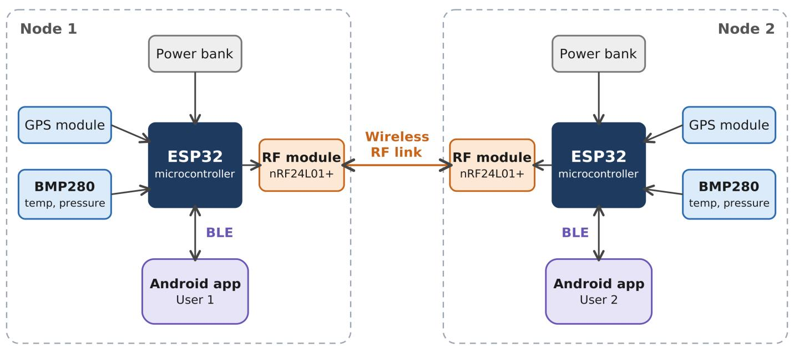
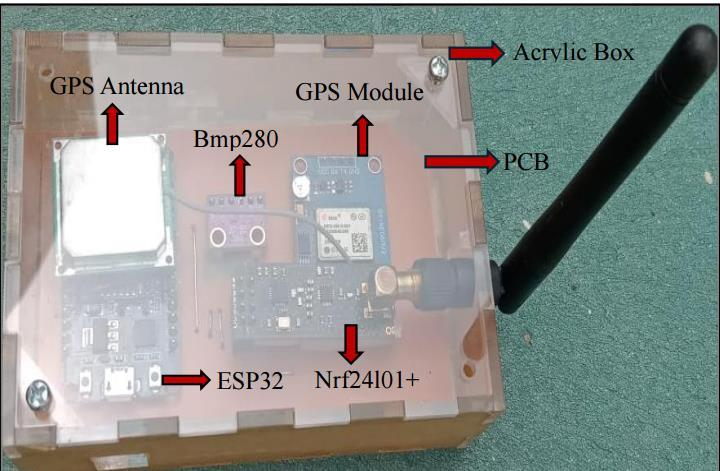
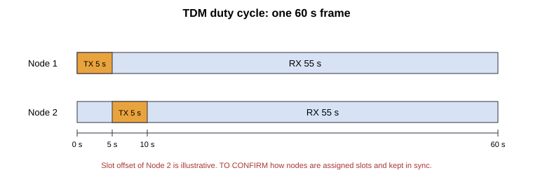

# Real-Time Tracking and Environment Monitoring Device for Outdoor Activities

## Overview

This repository contains the implementation of our Final Year Project (FYP), **Real-Time Tracking and Environment Monitoring Device for Outdoor Activities**, developed as part of the B.S. Electrical Engineering program at the **Institute of Space Technology (IST), Islamabad**.

The project provides a reliable communication and monitoring solution for outdoor environments where **cellular networks are unavailable or unreliable**. A network of portable devices shares real-time GPS locations with one another through RF communication while simultaneously monitoring environmental conditions for local storm prediction. An Android application (**Hikecast**) displays the received location and weather information using Bluetooth Low Energy (BLE).

**Supervisor:** Dr Adnan Zafar | **Co-Supervisor:** Mr. Ghayas Ud Din

---

## Problem Statement

Outdoor activities such as hiking, trekking, rescue missions, and military operations often take place in remote regions with little or no cellular coverage. Under these conditions, team members require a reliable method to:

* Share their locations with each other
* Monitor changing weather conditions
* Receive emergency alerts
* Operate independently of cellular infrastructure

This project addresses these challenges by creating a self-contained wireless network of tracking devices.

---

## Key Features

* 📍 Real-time GPS location sharing between multiple devices
* 📡 RF communication without cellular or Wi-Fi networks
* 🌦 Local weather prediction using the Zambretti Forecast Algorithm
* 🌡 Environmental monitoring using temperature and atmospheric pressure
* 📱 Android application for visualization, with offline maps
* 🔵 Bluetooth Low Energy (BLE) communication with the mobile application
* 🆘 SOS emergency alert system
* 🔋 Low-power design using a time-division (TDM) transmit/receive cycle
* 👥 Supports approximately **60–70 devices** in the network

---

## System Architecture



Each node:

* Acquires GPS coordinates.
* Measures environmental parameters.
* Predicts local weather conditions.
* Shares its location with other nodes using RF communication.
* Sends processed information to the Android application through BLE for visualization.

The communication network operates independently of cellular infrastructure, making it suitable for remote environments.

---

## Hardware Components



| Component | Interface | Current | Power |
| --- | --- | --- | --- |
| ESP32 Development Board | – | 130 mA | 0.429 W |
| NEO-6M GPS Module | UART | 45 mA | 0.148 W |
| BMP280 Temperature & Pressure Sensor | I²C | 2.7 µA | 8.91 µW |
| NRF24L01+PA+LNA RF Transceiver | SPI | 12.6 mA | 0.0445 W |
| **Total (3.3 V)** | | | **≈ 0.621 W** |

Battery 5V Power Bank (Can operate for 72 Hours).

---

## TDM Communication Scheme

To save power, each node transmits for **5 s per minute** and listens for **55 s per minute**.



* Two-way communication was tested in synchronous and asynchronous modes.
* Slot assignment and synchronisation method: asynchronous time division multiplexing scheme.
* Packet contents (latitude, longitude, altitude, date, time).

---

## Zambretti Weather Algorithm

1. Sea-level pressure is computed from pressure, temperature and altitude.
2. The pressure trend (falling, steady, rising) is found from the pressure derivative.
3. The result is mapped to **Fine**, **Cloudy** or **Stormy**.

The standard Zambretti formulas were kept, but the weather ranges were re-derived from data collected in several local environments.

| Outcome | Z1 | Z2 | Z3 |
| --- | --- | --- | --- |
| Fine | [0, 2] | [10, 12] | [8, 10] |
| Cloudy | [-2, -0.1] | (8, 10] | (6, 8] |
| Stormy | [-5, -2] | (5, 8] | (3, 6] |

The prediction is written to a BLE characteristic and shown in the app.

---

## Software Stack

* Arduino IDE
* C/C++
* React Native
* Google Maps API
* BLE Communication
* SPI
* UART
* I²C

---

## Communication Technologies

| Technology                 | Purpose                                                |
| -------------------------- | ------------------------------------------------------ |
| NRF24L01+PA+LNA            | Node-to-node wireless communication                    |
| Bluetooth Low Energy (BLE) | Communication between hardware and Android application |
| GPS                        | Real-time positioning                                  |
| I²C                        | BMP280 sensor interface                                |
| UART                       | GPS communication                                      |
| SPI                        | RF module interface                                    |

The ESP32 is the BLE server (3 services, up to 4 characteristics each in practice) and the phone is the client. Temperature and pressure are notified once per minute.

---

## Android Application

The Android application (**Hikecast**) provides:

* Live GPS location visualization of both nodes (ID 01, ID 02) on an offline map
* Live temperature and pressure with graphs
* Weather prediction display
* SOS emergency notifications

---

## Project Workflow

1. GPS acquires the user's location.
2. BMP280 measures temperature and atmospheric pressure.
3. ESP32 processes sensor data.
4. The Zambretti Forecast Algorithm predicts local weather conditions.
5. Nodes exchange location data using the NRF24L01 RF network.
6. Processed information is transmitted to the Android application using BLE.
7. Users can trigger an SOS alert that is broadcast throughout the network.

---

## Applications

* Hiking and Trekking
* Mountaineering
* Search and Rescue Operations
* Military Operations
* Disaster Response
* Outdoor Expeditions
* Remote Area Monitoring

---

## Results

| Result | Value | How measured |
| --- | --- | --- |
| Two-way RF communication range | approx. **1.1 km** | Open-field test, line of sight |
| Network size | **60–70 devices** | Theoretical |
| Weather prediction accuracy | **94%** | Predictions checked against actual weather |
| Node power consumption | **0.621 W** | Sum of component currents × 3.3 V |
| Location visualization and SOS broadcast | Working | Two-node field tests |

---

## Limitations

* The ESP32 supported only **4 BLE characteristics per service** in testing, not the 9 designed.
* BLE packets were truncated at **22 characters**.
* Decoding failed with the React Native base-64 library.
* Standard Zambretti ranges were inaccurate locally and had to be re-tuned.
* SOS delivery was unreliable due to concurrent tasks; fixed by handling SOS inside the transceiver loop with flags.
* Hardware testing used two nodes.

---

## Future Improvements

* LoRa integration for extended communication range
* Mesh networking for larger deployments
* Cloud synchronization when internet becomes available
* AI-based weather prediction
* Lower power optimization
* Cross-platform mobile application support

---

## 🚀 Download & Installation

To test the mobile application without setting up the entire development environment, you can download the ready-to-install app binary.

### 📱 Android App (APK)
* **Latest Stable Version:** (https://github.com/BushraNaseer/real-time-tracking-and-environment-monitoring-device/releases/tag/v1.0.0)
* **Direct Download:** 📥 (https://github.com/BushraNaseer/real-time-tracking-and-environment-monitoring-device/releases/download/v1.0.0/app-release.apk)

### 🛠️ Quick Installation Steps
1. Download the **APK file** using your Android smartphone.
2. Open the downloaded file. If prompted, enable **"Install from Unknown Sources"** in your phone settings.
3. Follow the on-screen prompts to complete the installation.
4. Turn on **Bluetooth** and grant the app its Bluetooth and location permissions, then power on the device before launching the app.

---

## 📝 Research & Publications

This project is based on our published research paper. If you use this work or find it helpful, please cite us:

* **Paper Title:** "Real-Time Tracking and Weather Monitoring Device"
* **Published In:** Proceedings of the Second International Conference on Aeronautical Sciences, Engineering and Technology, ICASET 2025, Springer, Singapore
* **Official Link:** 🌐 https://doi.org/10.1007/978-981-95-6445-3_8

### 📌 BibTeX Citation
```bibtex
@InProceedings{10.1007/978-981-95-6445-3_8,
author="Batool, Syeda Aemen
and Naseer, Bushra",
editor="Khan, Abid Ali
and Hossain, Mohammad Sayeed
and Maleque, Md Abdul
and Fotouhi, Mohammad
and Steuwer, Axel
and Kurtulus, Dilek Funda",
title="Real-Time Tracking and Weather Monitoring Device",
booktitle="Proceedings of the Second International Conference on Aeronautical Sciences, Engineering and Technology Vol:2",
year="2026",
publisher="Springer Nature Singapore",
address="Singapore",
pages="85--95",
isbn="978-981-95-6445-3"
}
```

---

## Team

* **Bushra Naseer** (200401007), B.S. Electrical Engineering, IST Islamabad
* **Aemen Batool** (200401029), B.S. Electrical Engineering, IST Islamabad

---

## License

Released under the **MIT License**. Please provide appropriate attribution if you use any part of this work. 
